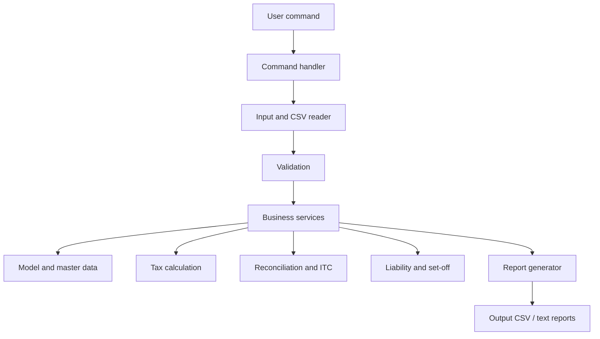

# System Architecture — PS-024 GST Application

## 1. Purpose

This document describes the planned architecture for the command-file-driven Java 17 application. The application has no graphical user interface. Users provide commands and input files; the application validates and processes GST data and writes reports to the `output/` folder.

## 2. Architecture style

The project uses a simple layered architecture. Each layer has one main responsibility:

1. **Command / application layer** — reads the user's command and coordinates the requested operation.
2. **Input/output layer** — reads CSV files and writes report files.
3. **Master-data layer** — stores taxpayer, customer, supplier, and item information.
4. **Business/service layer** — creates and validates invoices, calculates tax, reconciles purchase records, decides ITC eligibility, and calculates liability.
5. **Model layer** — contains the data objects shared by the other layers.

The application should call business services rather than putting GST calculations directly inside the command-line code.

## 3. High-level flow

## 4. Main modules

| Module | Responsibility |
|---|---|
| `model` | Core data classes such as Taxpayer, Party, Item, Invoice, InvoiceLine and PurchaseRecord |
| `master` | Register and retrieve taxpayer, customer, supplier and item master records |
| `invoice` | Create invoices, credit notes and debit notes; validate numbering and IRN rules |
| `tax` | Calculate taxable value, CGST, SGST, IGST and cess |
| `purchase` | Import purchase invoice records and GSTR-2B data |
| `reconciliation` | Normalize invoice numbers, compare book entries with GSTR-2B and assign statuses |
| `itc` | Determine eligible, blocked, held, reversed and re-availed input tax credit |
| `liability` | Calculate net tax liability, ITC set-off, interest and late fee |
| `validation` | Apply input validation and business-rule checks |
| `io` | Read command input and CSV files; write output files |
| `reports` | Generate outward register, reconciliation report and liability summary |

## 5. Important design decisions

- Use Java `BigDecimal` for monetary calculations. Do not use `double` for GST amounts.
- Use `LocalDate` for invoice dates, due dates and payment dates.
- Use `LocalDateTime` for IRN timing checks because the 24-hour rule includes time.
- Use enums for fixed values such as tax type, invoice type, reconciliation status and ITC decision.
- Keep business rules in service/helper classes so they can be unit-tested independently.
- Keep input parsing separate from validation and business calculations.
- Follow the assignment's stated business rules. Any unresolved interpretation is recorded in `decision-log.md`.

## 6. Processing precedence

The application must apply the required sequence:

1. Invoice validity (IRN and numbering)
2. Tax computation
3. GSTR-2B matching
4. Blocked-credit check
5. 180-day payment reversal
6. Proportionate reversal for exempt supplies
7. ITC set-off against liability

This order is important because a later step must not make an invalid earlier record eligible.

## 7. Error handling

- Invalid command: show supported commands and do not terminate unexpectedly.
- Missing input file: show the expected file path and required columns.
- Invalid row: report the row number and reason; do not silently accept it.
- Invalid business transaction: retain a clear validation message and prevent it from entering the relevant report/calculation.
- Unexpected error: show a concise message to the user and preserve enough detail for debugging.

## 8. Scope boundary

The application is an academic simulation. Unless the project organizer specifically requires a live government integration, IRN generation/validation is simulated using the assignment's rules; it does not claim to connect to the GST portal.
