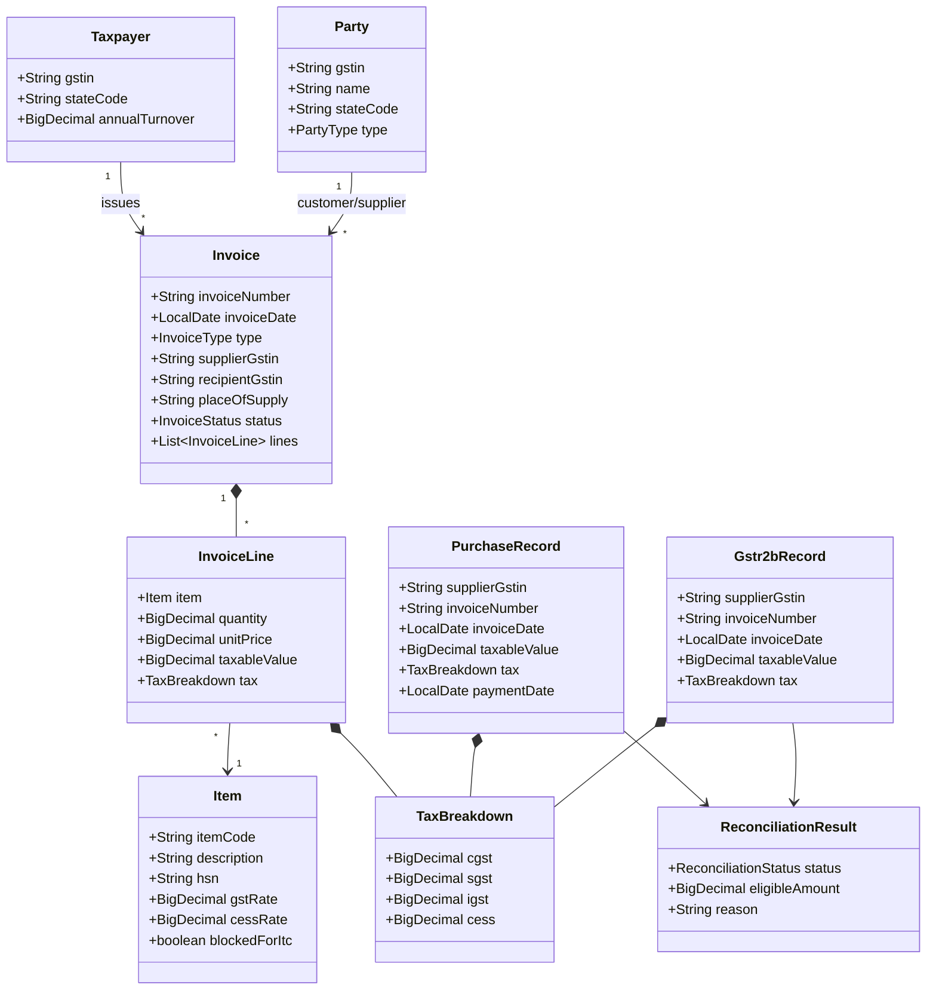

# Initial Class Diagram — PS-024 GST Application

This is the planned domain design. The implementation may add fields or split classes as the detailed requirements and sample files are received.

## Design notes

- `Party` represents a customer or supplier; a party type distinguishes its role.
- `Invoice` contains one or more `InvoiceLine` objects.
- `TaxBreakdown` keeps the tax heads separate so matching and set-off can compare each head.
- `PurchaseRecord` represents the buyer's books entry. `Gstr2bRecord` represents the corresponding imported 2B entry.
- `ReconciliationResult` stores the comparison outcome; it should not overwrite the original source records.
- Enums such as `InvoiceType`, `InvoiceStatus`, `PartyType` and `ReconciliationStatus` should be implemented as separate enum types when coding.
